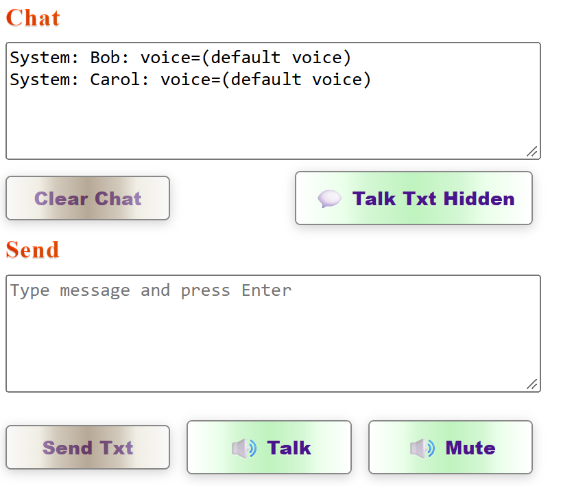

# Publishing and Voice Button Update

## Yesterday's publishing issue and solution

### Issue

Publishing to Azure failed because the previous Azure subscription was no longer available.  
Was prompted to **Re-enter credentials**. Did so but still kept saying that.

### Root cause

The deployment configuration still referenced the old subscription context.

### Solution

- Switched publishing to the current active Azure subscription.
- Updated the publish context/profile to use the correct subscription and target resources.
- Re-ran publish using the current subscription context.

  
***Just had to clear the old subscription reference as circled in green on right!***

### Outcome

Publishing proceeded successfully after moving to the current subscription.

---

## Today's changes related to voice buttons

### What changed

- Aligned the voice-related buttons to use the same class: `game-voice-button`.
  - Talk button
  - Mute/Unmute button
  - Toggle Voice-in-Chat button
- Updated voice button styling to use a light-green gradient override via button CSS variables.
- Ensured Talk button text is visible by wrapping `@TalkButtonText` in a `` so it layers above the button overlay.
- Kept all three controls on one line in the chat/voice row: Send, Talk, and Mute/Unmute.

### Result

Summary:

- Voice buttons now share consistent styling.
- The brown default button shading is overridden for voice buttons.
- Talk button text displays correctly.
- Layout is cleaner and consistent for chat/voice actions.

